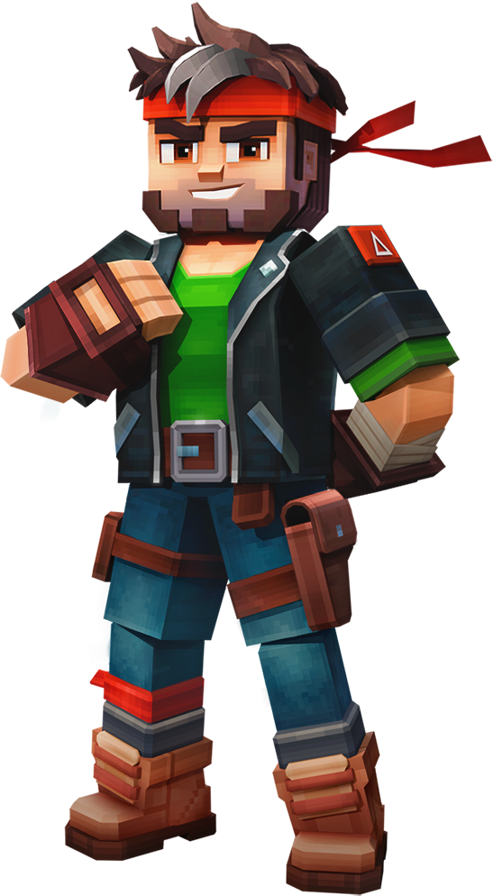

<div align="center">



# PixelGun2-Cheetos

**Internal x64 C++20 Overlay & Trainer for Pixel Gun 2**

[](https://isocpp.org/)
[](#)
[](https://store.steampowered.com/app/3456950/)
[](LICENSE)

*ImGui DX11/DX12 overlay • MinHook • 3-tier AOB / IL2CPP / Static RVA resolver • Automated post-patch tooling*

</div>

## Features

| Category | Feature | Description |
| :--- | :--- | :--- |
| **Visual** | **ESP Body** | X-Ray player highlight through walls (`ApplyVisualEffect`) |
| **Visual** | **ESP Box** | 2D bounding boxes projected via the active gameplay camera |
| **Visual** | **ESP Name** | Live player nametags via `MatchPresentation` / `PlayerStanding` |
| **Visual** | **Team Check** | Filters teammates out of ESP rendering |

### Controls

| Key | Action |
| :--- | :--- |
| `INSERT` | Toggle menu |
| `↑` / `↓` / `←` / `→` | Navigate & adjust sliders |
| `ENTER` | Toggle option / run action |
| `END` | Unload DLL cleanly |

## Quick Start

### Windows
1. Place `PG2-Cheetos.dll` and `PG2-Cheetos_Injector.exe` in the same folder.
2. Launch **Pixel Gun 2**, then run `PG2-Cheetos_Injector.exe`.
3. Press `INSERT` in-game to open the menu.

### Linux (Steam / Proton)
Requires [`protontricks`](https://github.com/Matoking/protontricks) (native or Flatpak):

```bash
# Inject into a running Pixel Gun 2 session
./resources/scripts/run.sh inject

# Or add to Steam Launch Options:
# /path/to/resources/scripts/run.sh %command%
```

<details>
<summary><b>Building from Source</b></summary>
<br>

Only `Release` (logging stripped) and `Debug` (`ENABLE_DEBUG_LOG` enabled) configurations are supported.

#### Linux / macOS (MinGW-w64 Cross-Compile)
Requires `cmake` (3.20+), `ninja` (or `make`), and `x86_64-w64-mingw32-g++`:

```bash
./resources/scripts/build release --injector   # Release DLL + Injector
./resources/scripts/build debug --injector     # Debug DLL + Injector
```

#### Windows (MSVC)
```powershell
cmake -B build -G Ninja -DBUILD_INJECTOR=ON -DCMAKE_BUILD_TYPE=Release
cmake --build build
```
Binaries are output to `build/bin/`.
</details>

## Support & Donations

If you find this project valuable and wish to support its ongoing development and game-patch maintenance, donations are greatly appreciated!

<details>
<summary><b>Click to expand Crypto Donation Addresses</b></summary>
<br>

| Asset | Badge | Address |
| :--- | :--- | :--- |
| **Bitcoin** |  | `bc1qpp50c2wuz5n2rq9jy3fxdmte7smcwu5rnegu6q` |
| **Ethereum** |  | `0xbF16e9cC4F75Dcd5c1DaD4443b9d8348eC196592` |
| **USDT** |  | `0xbF16e9cC4F75Dcd5c1DaD4443b9d8348eC196592` |
| **Solana** |  | `FLFVbCaYQWoPrm9rH1WLuoYmiVnC5CFWoCPzkNk2vzy2` |
| **BNB** |  | `0xbF16e9cC4F75Dcd5c1DaD4443b9d8348eC196592` |
| **Cardano** |  | `addr1qyhapduj2uvu8x4ct75hujtsx63uq375cxda8m25xgn7wep06zmey4cecwdtshaf0eyhqd4rcprafsvm60k4gv38uajq2z2l6a` |
| **Litecoin** |  | `LMNbzEJ3M4qtAxsYyxMBkT4rzjSBJvUc2M` |
| **Tron** |  | `TYNLxxQWERit64uNo8dSQX3CxdLmomtAq7` |
| **Dogecoin** |  | `DFwJXDQsqPEdpnWhXCMmBWMru9iqYqWhDn` |
| **Polygon** |  | `0xbF16e9cC4F75Dcd5c1DaD4443b9d8348eC196592` |

</details>

## License

This project licensed under [**Apache License 2.0**](LICENSE)
